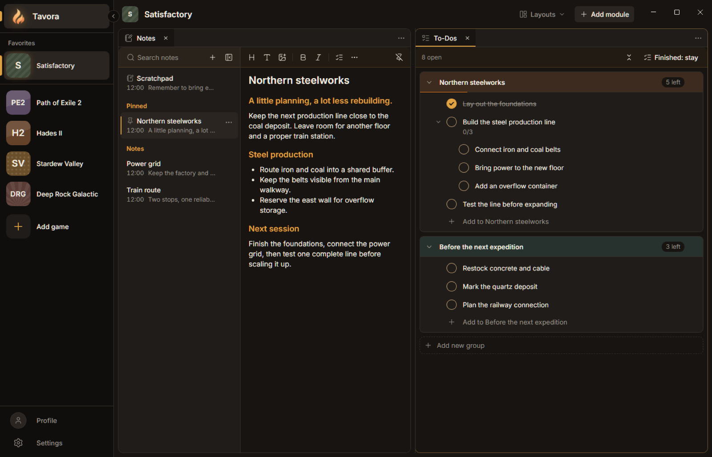
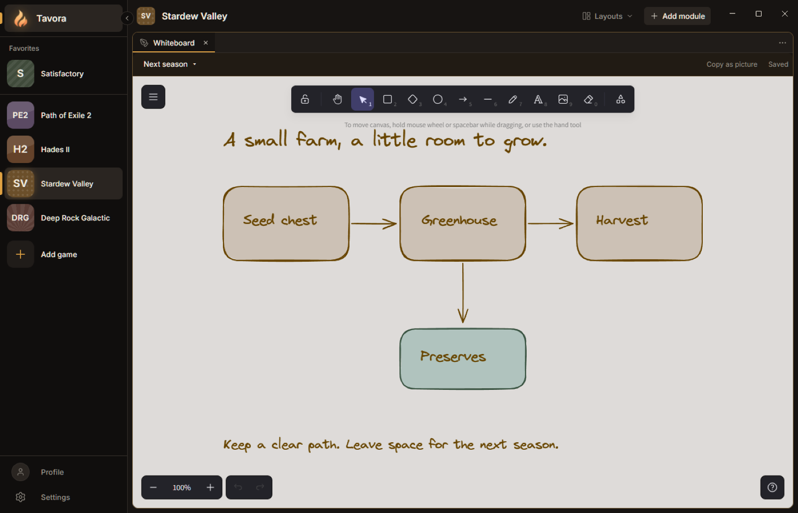
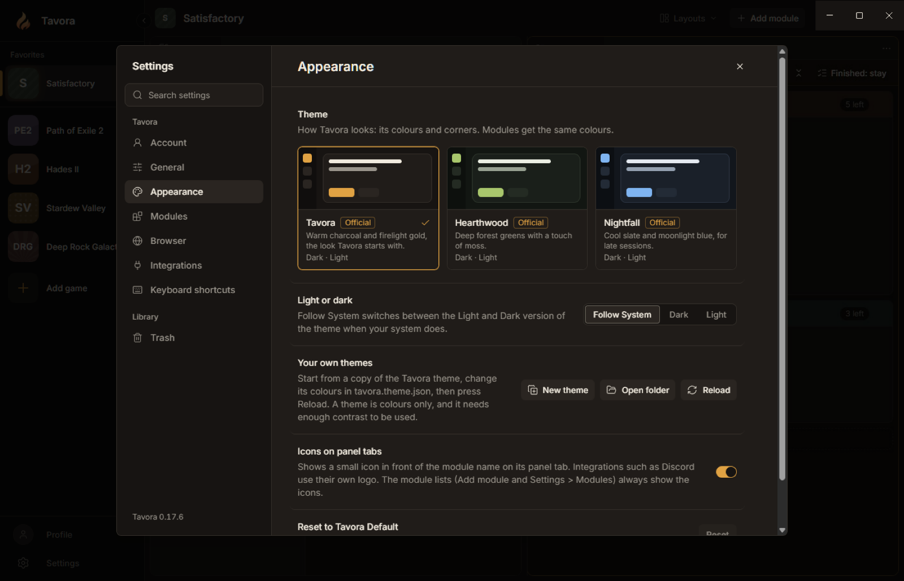

# Tavora

**Your games, with a workspace of their own.**

Tavora is a local-first gaming companion for your second monitor. Keep notes, to-dos, drawings, guides and other tools together in a dockable workspace for each game. Switch games, and Tavora restores that game's panels and saved work.

[Website](https://mytavora.app/) · [Developer docs](https://docs.mytavora.app/) · [Report a bug](https://github.com/wellbrained/tavora/issues)



*A Satisfactory workspace with sample notes and a factory checklist. The screenshots below use an isolated demo profile.*

> **Early development:** Tavora has installable Windows preview builds, but has not reached its first public 1.0 release. Features, saved-data formats and module APIs can still change. Windows is the primary platform; Linux has a source-build AppImage target and receives less testing. There is no macOS build.

## What you can do

- **Give every game its own workspace.** Arrange panels side by side or in tabs, resize them, maximize a panel, and save named layouts. Each game workspace remembers its own setup. Add a personal workspace for things that belong to no game.
- **Keep a game library.** Search the online game database, add a game by name, or import a public Steam library. Organize games with favorites and folders; removed games go to Trash before permanent deletion.
- **Write Notes.** Rich text, images, named and pinned notes, search, and a scratchpad for each workspace. Notes save automatically and can be open in several panels.
- **Track To-Dos.** Colored groups, sub-to-dos, pinned objectives, descriptions, and undo for finishing or deleting a task.
- **Sketch on a Whiteboard.** Multiple boards per workspace, drawing tools, pictures, and Copy as picture. Built on [Excalidraw](https://github.com/excalidraw/excalidraw).
- **Keep guides nearby.** The built-in Browser has per-workspace tabs and sign-ins, ad blocking, and a choice to share a site's sign-in across workspaces.
- **Add more tools.** Notes, To-Dos, a Whiteboard and a few more come with Tavora; everything else, such as Discord and AI Usage, you install from the catalog or a ZIP file. Modules ask before using capabilities such as named websites or host connectors.
- **Make it comfortable.** Three built-in themes, light/dark modes that can follow the system, custom themes, English and German, keyboard shortcuts, and Ctrl+K search.

**Discord voice access is currently limited to approved testers of Tavora's Discord app.** Discord account sign-in is separate. AI Usage reads supported Claude and Codex accounts on this PC through the host; modules do not receive their credentials.

### A place to think things through



*Whiteboard drawings and their pictures stay with the workspace. Copy a selection or the whole board as a PNG.*

### A look that follows you



*Themes apply to the host and modules. Each built-in theme includes light and dark variations.*

## Try the Windows preview

Download the current preview for Windows from the [latest release](https://github.com/wellbrained/tavora/releases/latest) (the `Tavora-Setup-<version>.exe` file). The [update feed](https://updates.mytavora.app/latest.yml) lists the latest published build. Install it, add a game, choose a layout, and use **Add module** to fill the panels. You can also start with the [source build](#run-from-source).

Preview builds are unsigned, so Windows may show an unrecognized-app warning. Installed Windows builds check for updates through `updates.mytavora.app`; automatic downloading can be changed in Settings.

An account is optional: email-code or Discord sign-in is available, but your local game library, notes and layouts do not require one. **Signing in does not sync game workspaces between PCs yet.** Modules from other people come from the module catalogue inside the app, or as ZIP files.

## Your data and module permissions

Game workspaces and module data are stored on your PC. On Windows, installed Tavora uses `%APPDATA%\@tavora\desktop`. Pictures normally live under that profile; their folder can be moved in Settings. Tavora keeps local backups and has **Copy diagnostic info** for troubleshooting.

Online features make their own connections: game search and accounts use Tavora's service; game icons can come from this PC, Steam and Tavora's icon service; Browser pages connect to the sites you open. Game search and icon fetching have switches in Settings.

Module pages run in a sandbox. The host validates their requests, scopes stored data by publisher, module and workspace, and checks granted capabilities on every call. Network grants name the allowed hosts; Discord and AI Usage use dedicated host connectors. An installable module does not get arbitrary access to your files, processes or account credentials. See the [security model](https://docs.mytavora.app/guide/security) for the precise boundaries and known limits.

## Run from source

Use Node.js 24 LTS and pnpm 10.28.0 (the repository pins pnpm in `package.json`; `.nvmrc` selects Node 24). The API service and the published packages for module developers still support Node 22, and CI tests them on it too.

```sh
corepack enable
pnpm install
pnpm build
pnpm dev
```

`pnpm dev` opens Tavora with hot reload at `http://127.0.0.1:4000`. Use `pnpm dev --port <n>` to choose another port. `pnpm dev --check` builds everything once and stops without opening Tavora (CI runs it). Closing Tavora or pressing Ctrl+C ends the development session.

- Host UI edits reload in place.
- Main-process and preload edits restart Tavora automatically.
- Official modules are built in watch mode; a successful rebuild restarts Tavora to load them.
- Example modules use their built files. Rebuild an example after editing it.

**Development and installed Tavora have separate persistent state.** On Windows, dev uses `%APPDATA%\@tavora\desktop-dev`; the installed app keeps `%APPDATA%\@tavora\desktop`. The first dev run starts empty; existing installed data is not copied. `TAVORA_USER_DATA` can select an explicit development/test profile.

To open the compiled source build without watchers:

```sh
pnpm --filter @tavora/desktop start
```

To run the developer documentation locally:

```sh
pnpm --filter @tavora/docs dev
```

### Build a standalone app

After `pnpm build`:

```sh
pnpm --filter @tavora/desktop package --win    # Windows installer, update files and ZIP
pnpm --filter @tavora/desktop package --linux  # AppImage; build on Linux
```

Artifacts go to `apps/desktop/release/`. Packaged builds use the installed-app profile and include the official modules, themes and example modules. Unlike development runs, a packaged build ignores development-only profile and server overrides.

## Build a module

A module is a small web app with a `tavora.module.json` manifest and built assets. The host supplies the current workspace, theme, language and permitted APIs through the TypeScript [`@tavora/sdk`](packages/sdk/README.md).

Start with the [developer guide](https://docs.mytavora.app/guide/getting-started), or an example in [vanilla TypeScript](examples/vanilla-module), [React](examples/react-module) or [Vue](examples/vue-module), and one with [several panel types](examples/panels-module). The official modules use the same SDK. The UI Playground shows Tavora's shared controls and styling.

The SDK and packaging tools currently live in this repository and are not published to npm. Signed module ZIPs, permission prompts and publisher-bound updates are implemented; the broader outside-developer workflow is still being built. APIs are not stable before 1.0. The [manifest reference](apps/docs/reference/manifest.md), [bridge protocol](apps/docs/reference/protocol.md) and [theme format](apps/docs/reference/theme.md) describe the current contracts.

## Repository map

| Path | Purpose |
| --- | --- |
| `apps/desktop` | Electron host, Vue UI, dockable views, Browser, permissions and local storage |
| `apps/api` | Game search, Steam import, accounts and the hosted game-icon service |
| `apps/docs` | VitePress developer documentation and generated SDK reference |
| `packages/sdk` | Typed module client and wire-protocol types |
| `packages/module-schema` | Manifest types, validation, JSON Schema and ID rules |
| `packages/pack` | Module ZIP packing, signatures and archive validation |
| `modules/` | Notes, To-Dos, Whiteboard, Discord, AI Usage, UI Playground and shared UI code |
| `examples/` | Vanilla, React and Vue module examples, plus a theme starter |
| `themes/` | Tavora, Hearthwood and Nightfall theme packages |
| `docs/screenshots` | Screenshots used in this README |
| `brand/` | Tavora logo sources and exported brand assets |

The marketing website is maintained in the separate `tavora-website` repository.

## Checks and releases

```sh
pnpm check       # typecheck, unit tests, build, then Electron tests
pnpm typecheck
pnpm test
pnpm build
pnpm test:e2e
```

Electron tests need a display and must run as a normal user with Chromium's sandbox enabled. On headless Linux, use `xvfb-run -a pnpm test:e2e`.

GitHub **Checks** runs typechecking, unit tests, builds, and a Windows install/start check on pull requests and pushes to `main`. The full Electron suite also runs on release tags, or on a manual workflow run when selected. `pnpm check` runs it locally. The root checks and builds exclude `apps/docs`; the docs site has its own build/deploy commands.

App changes don't raise the version in the PR. They add a change note to `apps/desktop/changes/` ([how](apps/desktop/changes/README.md)), and when the PR merges the **Number** workflow gives it the next patch version, raises the root and desktop `package.json` and adds its entry to `apps/desktop/src/shared/patch-notes.ts`. A note with `bump: minor` needs the `feature-complete` label on the PR. Docs, CI and tooling-only changes add no note.

On the maintainer's PC, release from clean, up-to-date `main` after pushing and passing GitHub Checks. Users see one patch-notes entry per release, so first fold the entries since the last release into the newest one: `pnpm release:fold` writes a draft on a new branch (every note, pull request and tag kept) and lists what to check in the wording; merge it as a pull request.

```sh
pnpm release:fold       # draft: the patch notes since the last release as one entry, then go over the wording
pnpm release --dry-run  # everything up to the upload: GitHub builds and tests, this PC checks the files
pnpm release            # publish the current version (patch or minor)
```

Patch releases are normal; the server refuses a version that is not newer than the live one. The release is split (decided 2026-10-30): the script checks versions, tags and patch notes, then starts the **Release build** workflow on GitHub, which runs typecheck, unit and e2e tests, packages the Windows app, installs and starts it, and attests the files, with no secrets. Before it builds, CI checks that every pnpm-patched dependency is really patched (`pnpm check:patches`; it also runs in Checks and `pnpm check`). The PC downloads the files, checks them against the SHA-256 the run printed and GitHub's attestation for that commit, uploads them, tags the commit and creates the GitHub release from the same files. From 1.0 on it also asks for checks of the **new installed version** (before 1.0 they are only listed). The server publishes the installer and blockmap before atomically switching `latest.yml`. Finally, verify that a previously installed version updates successfully. The upload uses the restricted `tavora-updates` key; every deploy (update feed, docs, API, Tavora Admin) has its own key that can only hand over one upload, set up as described in [deploy/README.md](deploy/README.md).

## License and security

Code is available under the [MIT License](LICENSE). The Tavora name and logo are not covered by that license and may not be used to brand forks or derived apps. Game names and logos belong to their respective owners; Tavora is not affiliated with their publishers.

To report a security issue, follow [SECURITY.md](SECURITY.md).
